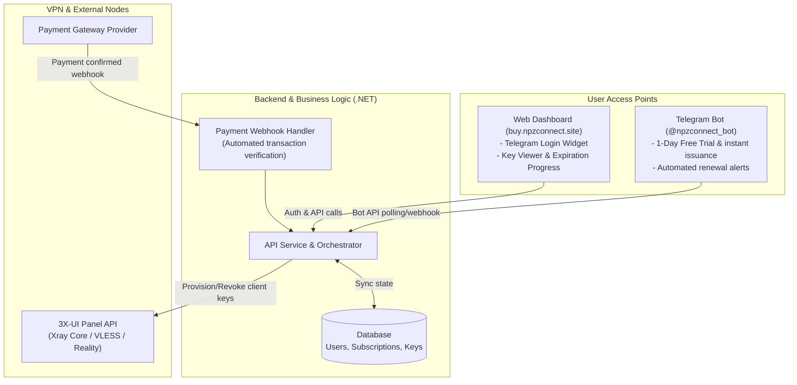

# ⚡ NPZ Connect — Automated VPN & Subscription Platform

> **Production Case Study:** An end-to-end commercial subscription system providing high-speed, censorship-resistant VPN access with automated cryptographic key provisioning, multi-channel user management, and payment gateway integration.  
> 🎁 **Free 1-Day Trial** is available instantly via the Telegram bot.

---

## 🏗️ System Architecture

---

## 🌟 Key Engineering Highlights

- **Automated Client Lifecycle:** Zero human intervention required — accounts and VLESS/Reality keys are instantly provisioned and revoked via the 3X-UI REST API upon subscription triggers.
- **Instant Free Trial Onboarding:** Users can immediately test connection quality with a 1-day free trial issued directly through the Telegram bot.
- **Resilient Payment Webhooks:** Robust transactional handling for asynchronous payment status notifications to guarantee zero lost transactions.
- **Multi-Channel Delivery:** Unified session state accessible both via a responsive Web Dashboard (authenticated via Telegram Widget) and a Telegram Bot.
- **Real-Time Subscription Tracking:** Dynamic expiration calculation, visual progress bar indicators, and automated renewal reminders.

---

## 🛠️ Technology Stack

| Layer | Technologies |
| :--- | :--- |
| **Backend** | C#, .NET / ASP.NET Core, HttpClient orchestration |
| **Infrastructure** | 3X-UI Panel, Xray Core (VLESS / Reality protocol) |
| **Frontend** | Responsive Glassmorphism UI, CSS custom properties, Telegram Auth Widget |
| **Integrations** | Telegram Bot API, Commercial Payment Gateway API |

---

## 🔗 Live Production Links

* 🌐 **Web Dashboard:** [https://buy.npzconnect.site](https://buy.npzconnect.site)
* 🤖 **Telegram Bot (with 1-day free trial):** [https://t.me/npzconnect_bot](https://t.me/npzconnect_bot)
